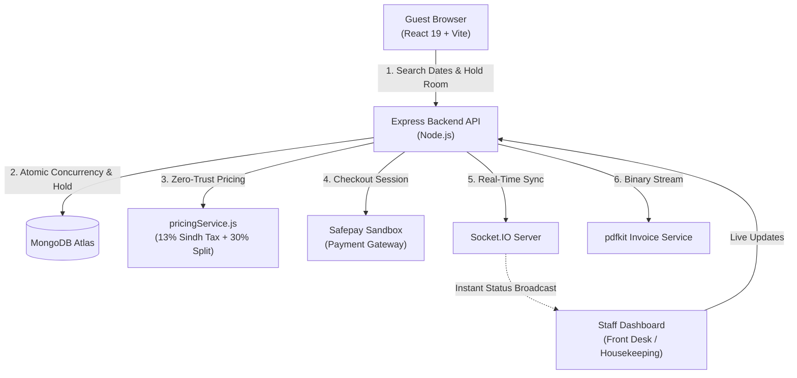

# Stayza Resorts & Suites — Hotel Management System (HMS)

> **Modern MERN Stack Hotel Management System & Guest Reservation Engine**  
> Features zero-trust pricing calculations, atomic 5-minute concurrency holds, Safepay sandbox checkout, real-time Socket.IO synchronization, and automated server-side PDF invoices.

[](https://mongodb.com)
[](https://react.dev)
[](https://tailwindcss.com)
[](https://nodejs.org)
[](https://mongodb.com)
[](https://getsafepay.com)

---

## 🌐 Live Deployments

* **Frontend Web Application:** [https://stayza.web.app](https://stayza.web.app) *(Mirror: [https://habittas.web.app](https://habittas.web.app))*
* **Backend REST API:** [https://hotel-ms-mu.vercel.app](https://hotel-ms-mu.vercel.app)
* **GitHub Repository:** [https://github.com/ahmed-husssain/HotelMS](https://github.com/ahmed-husssain/HotelMS)

---

## 📑 Table of Contents

1. [Project Overview](#-project-overview)
2. [Key Features](#-key-features)
3. [User Roles & Access Control](#-user-roles--access-control)
4. [System Architecture](#-system-architecture)
5. [Technology Stack](#-technology-stack)
6. [Project Structure](#-project-structure)
7. [Local Setup & Installation](#-local-setup--installation)
8. [Test Accounts & Credentials](#-test-accounts--credentials)

---

## 🏨 Project Overview

**Stayza Resorts & Suites** is an end-to-end hospitality management application designed to handle real-world hotel workflows:

* **For Guests:** Explore luxury suites, check real-time availability, lock rooms with a 5-minute temporary hold, pay a 30% advance deposit via Safepay, and manage their stay via a self-service guest portal (digital key, room service ordering, live billing).
* **For Hotel Staff:** Streamline operations with dedicated role-based portals for Front Desk Receptionists, Housekeeping, and General Management.
* **For Examiners & Developers:** Clean, standard, zero-trust codebase where all financial calculations and room availability are validated strictly on the backend to prevent tampering.

---

## 🚀 Key Features

### 1. Guest Journey & Booking Engine
* **Dynamic Room Showcase:** Categorized luxury suites (Oceanfront Villa, Beach Suite, Horizon Penthouse) with high-resolution photography and expandable room feature drawers.
* **Atomic 5-Minute Room Hold:** When a guest proceeds to checkout, the system places a temporary 5-minute hold (`holdExpiresAt`) on the room in MongoDB, preventing double-booking race conditions.
* **Zero-Trust Pricing:** Nightly rates, date calculations, the 13% Sindh Sales Tax, 30% online advance deposit, and 70% front-desk balance are calculated exclusively on the backend (`pricingService.js`).
* **Safepay Sandbox Payments:** Secure online advance deposit collection with automatic transaction verification.
* **Guest Portal (`/my-stay`):** Instant access to interactive digital room keys, room service ordering, live room folio bills, and 5-star review submissions.

### 2. Front Desk Operations (`/front-desk`)
* **Arrivals & In-House Board:** View guests checking in today, in-house residents, and departures.
* **Check-In & Check-Out:** Collect the remaining 70% balance at check-out and automatically record settlement.
* **7-Suite Room Rack:** Visual grid showing live room statuses (*Available*, *Occupied*, *Needs Cleaning*, *In Cleaning*, *Maintenance*).
* **Extra Services & Charges:** Post additional dining or laundry charges directly to the guest's room bill.
* **Shift Closing:** Daily cashier shift handover report tracking collected cash and online revenue.

### 3. Housekeeping & Facilities (`/housekeeping`)
* **Daily Cleaning Queue:** Check out/in-house cleaning workflow with step-by-step checklist certification.
* **Live Guest Requests:** Receive incoming service orders (extra towels, mineral water, room dining) from guests in real time.
* **Maintenance Ticketing:** Report room defects, mark priority levels, and lock rooms out of inventory until resolved.
* **Supplies & Linen Inventory:** Track stock counts for everyday hotel amenities with quick restock controls.

### 4. Executive Management & Admin (`/admin`)
* **Hotel Analytics:** Live occupancy rate %, Average Daily Rate (ADR), RevPAR, and gross collected revenue.
* **Staff Management (RBAC):** Create and manage staff accounts across 4 roles (*Guest*, *Receptionist*, *Housekeeping*, *Admin*).
* **Room Pricing Manager:** Update base nightly rates per suite on MongoDB in real time.
* **Activity Log:** Audit trail of all staff operations, status updates, and check-ins with one-click CSV export.

### 5. Automated PDF Invoices & Receipts
* Server-side PDF generation via `pdfkit` streaming official tax vouchers directly to guests and staff via `GET /api/bookings/:reference/invoice`.

---

## 👥 User Roles & Access Control

Role-Based Access Control (RBAC) is enforced cryptographically on the Express backend via JWT tokens:

| Role | Access URL | Permissions |
| :--- | :--- | :--- |
| **Guest** | `/my-stay` | Search suites, reserve rooms, pay 30% advance, unlock digital key, order room service. |
| **Receptionist** | `/front-desk` | View arrivals, execute check-in/out, post extra charges, manage Room Rack, close cashier shifts. |
| **Housekeeping** | `/housekeeping` | Complete room cleaning checklists, report maintenance issues, deliver guest requests, restock inventory. |
| **Admin** | `/admin` | Access financial analytics, update room prices, provision staff accounts, inspect activity logs. |

---

## 🏛 System Architecture



---

## 🛠 Technology Stack

| Layer | Technologies |
| :--- | :--- |
| **Frontend** | React 19, Vite 8, Tailwind CSS v4, React Router v7, Lucide Icons, GSAP & Lenis smooth scroll |
| **Backend** | Node.js, Express.js, JWT (jsonwebtoken), bcryptjs, Morgan logger |
| **Database** | MongoDB Atlas with Mongoose ODM (strict schema validation) |
| **Payments** | Safepay Sandbox (Hosted Checkout & Webhook Reconciliation) |
| **Real-Time** | Socket.IO (instant synchronization between Housekeeping and Front Desk) |
| **Documents** | PDFKit (in-memory binary PDF streaming) |
| **Hosting** | Frontend on Firebase Hosting &middot; Backend on Vercel |

---

## 📁 Project Structure

```
Hotel-Management/
├── client/                     # Frontend React application
│   ├── src/
│   │   ├── components/         # Reusable UI, Admin, PMS, and Booking components
│   │   ├── context/            # AuthContext & HotelDataContext
│   │   ├── pages/              # LandingPage, BookingPage, FrontDeskPage, etc.
│   │   └── services/           # api.js (backend HTTP client)
│   ├── index.html
│   ├── package.json
│   └── vite.config.js
├── server/                     # Backend Express REST API
│   ├── src/
│   │   ├── config/             # MongoDB connection (db.js)
│   │   ├── controllers/        # Business logic (booking, auth, room, staff, report)
│   │   ├── middleware/         # auth.js (JWT) & rbac.js (Role guards)
│   │   ├── models/             # Mongoose schemas (User, Room, Booking, Payment, etc.)
│   │   ├── routes/             # Express API route definitions
│   │   ├── services/           # availabilityService, pricingService, invoiceService
│   │   └── utils/              # Database seed script (seedData.js)
│   ├── server.js               # Application entry point & Socket.IO initialization
│   └── package.json
└── docs/                       # Project specifications, rules, and drafts
```

---

## 💻 Local Setup & Installation

### Prerequisites
* **Node.js** v18+ installed
* **MongoDB Atlas** cluster URI (or local MongoDB running)

### 1. Clone the Repository
```bash
git clone https://github.com/ahmed-husssain/HotelMS.git
cd HotelMS
```

### 2. Backend Setup
```bash
cd server
npm install

# Create .env file
copy .env.example .env
```

Ensure `server/.env` contains your MongoDB connection string and credentials:
```env
PORT=5000
NODE_ENV=development
MONGO_URI=your_mongodb_connection_string
JWT_SECRET=your_jwt_secret_key
CLIENT_URL=http://localhost:5173
SAFEPAY_API_KEY=your_sandbox_api_key
SAFEPAY_SECRET_KEY=your_sandbox_secret_key
```

Seed initial hotel inventory, suites, and staff accounts:
```bash
npm run seed
```

Start the backend server:
```bash
npm run dev
# Server runs on http://localhost:5000
```

### 3. Frontend Setup
In a new terminal:
```bash
cd client
npm install
npm run dev
# Application opens on http://localhost:5173
```

---

## 🔑 Test Accounts & Credentials

The seed script (`npm run seed`) provisions pre-configured accounts for testing:

| Role | Email | Password | Access Route |
| :--- | :--- | :--- | :--- |
| **General Manager (Admin)** | `admin@stayza.com` | `Password123!` | `/admin` |
| **Front Desk Receptionist** | `reception@stayza.com` | `Password123!` | `/front-desk` |
| **Housekeeping Lead** | `cleaning@stayza.com` | `Password123!` | `/housekeeping` |
| **Registered Guest** | `guest@stayza.com` | `Password123!` | `/my-stay` |

*(You can also register a new guest account directly at `/register`)*

---

## 📄 License & Academic Attribution
Developed as an enterprise-grade academic eProject for the Aptech Learning curriculum (MERN Stack). All business logic, pricing services, and atomic availability holds are engineered from first principles.
