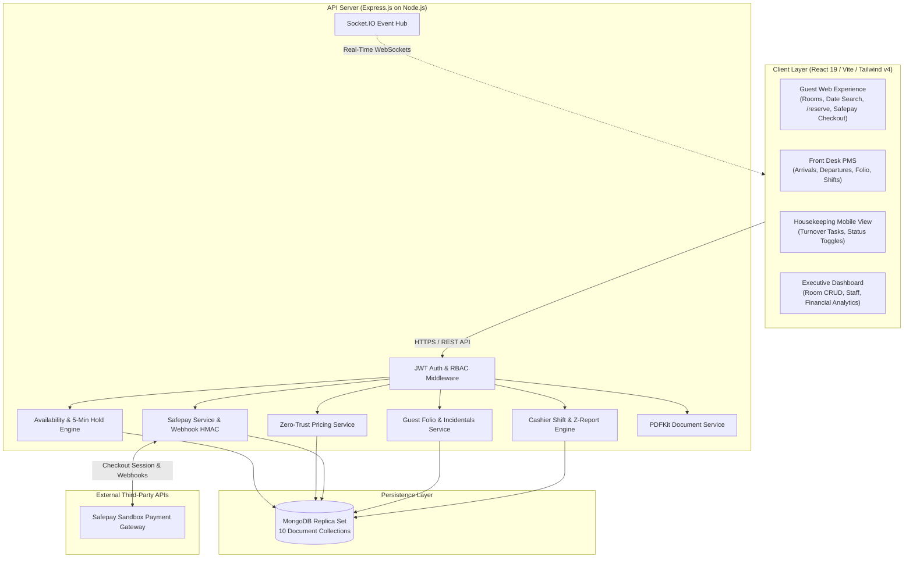
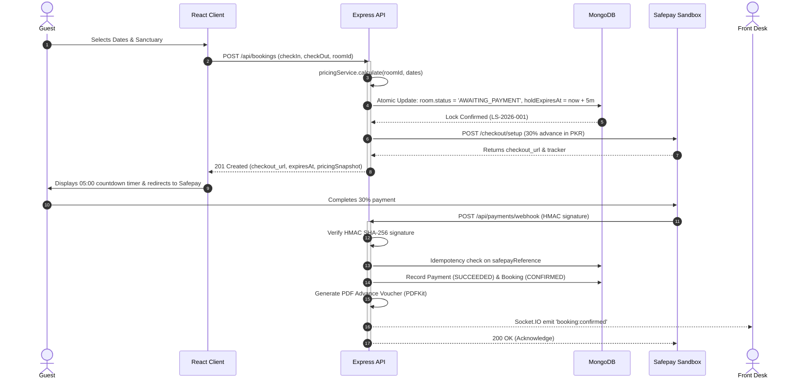
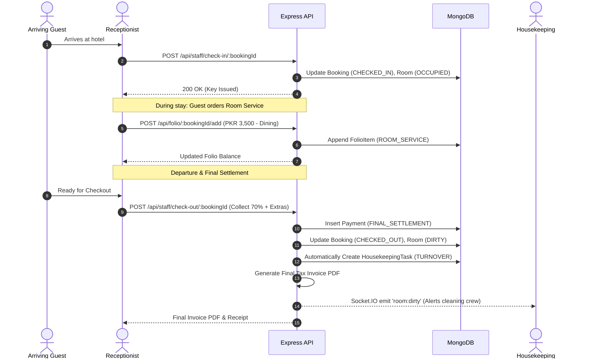

# THE HAVEN — LuxuryStay Hotel Management System (HMS)

> **Commercial-Grade MERN Stack Luxury Hospitality PMS & Guest Reservation Engine**  
> *Crafted for high-end coastal sanctuaries, featuring zero-trust financial calculations, atomic 5-minute concurrency holds, real-time Socket.IO synchronization, and an Awwwards-caliber editorial guest portal.*

[](https://mongodb.com)
[](https://react.dev)
[](https://tailwindcss.com)
[](https://socket.io)
[](https://getsafepay.com)
[](https://gsap.com)

---

## 📑 Table of Contents
1. [Product Overview & Vision](#-product-overview--vision)
2. [Core Architectural Pillars](#-core-architectural-pillars)
3. [User Roles & RBAC Matrix](#-user-roles--rbac-matrix)
4. [System Architecture & Sequence Flows](#-system-architecture--sequence-flows)
5. [Domain Data Models (10 Schemas)](#-domain-data-models-10-schemas)
6. [Complete REST API Specification](#-complete-rest-api-specification)
7. [Tech Stack & Engineering Standards](#-tech-stack--engineering-standards)
8. [Directory Structure](#-directory-structure)
9. [Installation & Local Setup](#-installation--local-setup)
10. [Database Seeding & Test Credentials](#-database-seeding--test-credentials)
11. [Viva Defense & Examiner Q&A Guide](#-viva-defense--examiner-qa-guide)
12. [License & Documentation Links](#-license--documentation-links)

---

## 🏛 Product Overview & Vision

**The Haven** (LuxuryStay) is designed to mirror commercial hospitality standards practiced by ultra-luxury boutique properties (e.g., *Aman, Cheval Blanc, Bvlgari Hotels*). Unlike standard academic projects with toy tables and naive forms, this system enforces **real-world financial, operational, and concurrency constraints**:

* **Two-Tier Split Billing:** 30% online advance deposit via Safepay to secure reservation + remaining 70% collected at front desk upon check-in/out.
* **Pessimistic Concurrency:** A 5-minute atomic inventory hold (`holdExpiresAt`) ensures zero double-booking even under aggressive concurrent checkout requests.
* **Zero-Trust Pricing Architecture:** The browser is never trusted. All nightly pricing, 13% hospitality taxes, deposits, and balances are computed exclusively on the backend (`pricingService.js`).
* **Real-Time Multi-Department Synchronization:** WebSockets link Front Desk, Housekeeping queues, and Guest portals without page refreshes.
* **Audit-Proof Accounting:** Cashier shift management with Z-Report reconciliation, immutable payment audit ledgers, and automated PDFKit invoice generation.

---

## ⚡ Core Architectural Pillars

### 1. Zero-Trust Backend Pricing
* Clients only send dates and desired room IDs. 
* Nightly rates, tax schedules (13% Sindh Hospitality Tax), length-of-stay math, and advance deposit splits (30% / 70%) are calculated and cryptographically frozen inside the booking record on the server.
* Once a reservation is created, price snapshots are immutable; future room rate changes by management never alter past bookings.

### 2. 5-Minute Atomic Pessimistic Hold
* When checkout begins, the room transitions to `AWAITING_PAYMENT` with `holdExpiresAt = Date.now() + 5 minutes`.
* During these 300 seconds, the room is locked exclusively for that guest.
* If the user abandons checkout, the client triggers `POST /api/bookings/:id/release-hold` to free the room immediately; otherwise, a background TTL sweeper frees expired locks.

### 3. Safepay Hosted Checkout & Idempotent Webhooks
* Generates a hosted checkout URL for the exact 30% advance deposit in PKR.
* Webhooks verify HMAC SHA-256 signatures (`x-sfpy-signature`).
* Enforces strict idempotency on `safepayReference`: duplicate webhook notifications from Safepay are safely acknowledged without double-crediting.

### 4. Cashier Shifts & Z-Report Reconciliations
* Front-desk receptionists open a shift session with an opening float (cash in drawer).
* System automatically tracks every transaction (cash, card POS) handled during that shift.
* On shift close, generates a formal **Z-Report** comparing expected vs. actual physical cash, logging discrepancies to the audit log.

### 5. Automated Housekeeping & Real-Time Sync
* Checking out a guest instantly transitions the room to `DIRTY` and dispatches a task to the housekeeping queue.
* When housekeeping toggles a room to `CLEANING` $\rightarrow$ `AVAILABLE`, front-desk arrivals monitors update within $<500\text{ms}$ via Socket.IO.

---

## 👥 User Roles & RBAC Matrix

The platform enforces strict Role-Based Access Control (RBAC) via `src/middleware/rbac.js`:

| Capability / Endpoint | Guest | Receptionist | Housekeeping | General Manager (Admin) |
|:---|:---:|:---:|:---:|:---:|
| Search rooms & real-time date availability | ✅ | ✅ | ✅ | ✅ |
| Initiate 5-minute atomic checkout hold | ✅ | ✅ | ❌ | ✅ |
| Pay 30% advance deposit via Safepay | ✅ | ❌ | ❌ | ❌ |
| View personal bookings & download PDF vouchers | ✅ | ❌ | ❌ | ✅ |
| Live Front Desk arrivals, stayovers & departures | ❌ | ✅ | ❌ | ✅ |
| Check-in guest & assign physical room keys | ❌ | ✅ | ❌ | ✅ |
| Post incidental charges to guest folio (Food, Spa) | ❌ | ✅ | ❌ | ✅ |
| Collect 70% balance & print final tax invoice | ❌ | ✅ | ❌ | ✅ |
| Open / Close Cashier Shift & print Z-Report | ❌ | ✅ | ❌ | ✅ |
| View dirty room turnover queue | ❌ | ✅ | ✅ | ✅ |
| Update room cleaning status in real time | ❌ | ❌ | ✅ | ✅ |
| Log maintenance repair tickets with urgency levels | ❌ | ✅ | ✅ | ✅ |
| Manage room catalog (CRUD, nightly rates) | ❌ | ❌ | ❌ | ✅ |
| Manage staff accounts & permissions | ❌ | ❌ | ❌ | ✅ |
| Executive revenue, occupancy & audit reports | ❌ | ❌ | ❌ | ✅ |

---

## 🔄 System Architecture & Sequence Flows

### 1. High-Level Component Topology



---

### 2. The 5-Minute Pessimistic Booking & Payment Flow



---

### 3. Check-in, Incidentals Folio & Checkout Flow



---

## 🗄 Domain Data Models (10 Schemas)

Located in [`server/src/models/`](file:///D:/Hotel-Management/server/src/models):

| # | Model | Collection | Purpose |
|:---|:---|:---|:---|
| 1 | **User** | `users` | Role-based accounts (`guest`, `receptionist`, `housekeeping`, `admin`) with bcrypt password hashing (10 salt rounds). |
| 2 | **Room** | `rooms` | Single unified inventory model storing room numbers, suite types, base nightly rates, amenities, floor, and live status (`AVAILABLE`, `AWAITING_PAYMENT`, `OCCUPIED`, `DIRTY`, `CLEANING`, `MAINTENANCE`). |
| 3 | **Booking** | `bookings` | Core reservation document holding immutable `pricingSnapshot` (nights, rates, tax, advance, balance), guest details, and `holdExpiresAt`. |
| 4 | **Payment** | `payments` | Audit ledger storing every monetary event (Safepay advance, desk cash, card POS) with unique transaction references and idempotency keys. |
| 5 | **FolioItem** | `folio_items` | Incidental charges incurred during stay (Room Service, Laundry, Minibar, Spa, Airport Transfer) linked to booking and guest. |
| 6 | **Invoice** | `invoices` | Formal tax invoices and advance payment vouchers with unique sequential serial numbers (`INV-2026-XXXX`). |
| 7 | **HousekeepingTask** | `housekeeping_tasks` | Cleaning queues automatically created on checkout or manual dispatch with status tracking (`PENDING`, `IN_PROGRESS`, `INSPECTED`). |
| 8 | **MaintenanceRequest** | `maintenance_requests` | Facility defect tickets (HVAC, plumbing, electrical) with urgency tiers (`LOW`, `MEDIUM`, `HIGH`, `URGENT`) locking rooms into `MAINTENANCE`. |
| 9 | **CashierShift** | `cashier_shifts` | Shift accounting sessions recording opening cash float, total collections by tender type, and closing Z-Report variance notes. |
| 10 | **ActivityLog** | `activity_logs` | Immutable audit trail capturing security-sensitive actions (check-ins, balance collections, status overrides, manual discounts). |

---

## 🔌 Complete REST API Specification

### Authentication & Profiles (`/api/auth`)
* `POST /api/auth/register` — Create a new guest or staff account.
* `POST /api/auth/login` — Authenticate and receive JWT token.
* `GET /api/auth/me` — Retrieve authenticated user profile and permissions.

### Rooms & Inventory (`/api/rooms`)
* `GET /api/rooms` — Search and filter rooms by date range and guest capacity.
* `GET /api/rooms/:id` — Detailed room monograph with photo gallery and floor plan.
* `POST /api/rooms` — *(Admin)* Create a new room record.
* `PUT /api/rooms/:id` — *(Admin)* Update room amenities, status, or base nightly rates.
* `DELETE /api/rooms/:id` — *(Admin)* Soft-deactivate a room.

### Bookings & Concurrency Holds (`/api/bookings`)
* `POST /api/bookings` — Calculate backend pricing and acquire 5-minute atomic hold.
* `GET /api/bookings/:id` — Retrieve booking folio details and hold countdown.
* `POST /api/bookings/:id/release-hold` — Explicitly release 5-minute hold upon cart cancellation.
* `GET /api/bookings/my-reservations` — Guest's personal booking history and downloadable receipts.

### Payments & Gateway Webhooks (`/api/payments`)
* `POST /api/payments/checkout-session` — Initialize Safepay hosted checkout for 30% advance deposit.
* `POST /api/payments/webhook` — HMAC SHA-256 verified webhook handler for asynchronous payment capture.
* `GET /api/payments/:id/receipt` — Stream generated PDF advance payment voucher.

### Front Desk Operations (`/api/staff`)
* `GET /api/staff/arrivals` — Expected arrivals for today's date.
* `GET /api/staff/in-house` — Current checked-in guests and occupied rooms.
* `GET /api/staff/departures` — Today's departures and pending folio balances.
* `POST /api/staff/check-in/:id` — Confirm arrival, assign room key, switch status to `OCCUPIED`.
* `POST /api/staff/check-out/:id` — Collect remaining 70% + folio extras, print final tax invoice, set room to `DIRTY`.

### Guest Folio Incidentals (`/api/folio`)
* `GET /api/folio/:bookingId` — Itemized stay charges breakdown.
* `POST /api/folio/:bookingId/add` — Post incidental charge (e.g., Minibar PKR 1,800).
* `DELETE /api/folio/item/:id` — Void accidental charge with mandatory audit reason.

### Housekeeping & Facility Maintenance (`/api/housekeeping`, `/api/maintenance`)
* `GET /api/housekeeping/queue` — Real-time queue of dirty and cleaning rooms.
* `PUT /api/housekeeping/:id/status` — Update task status (`IN_PROGRESS` $\rightarrow$ `INSPECTED` $\rightarrow$ `AVAILABLE`).
* `POST /api/maintenance/create` — Flag a room maintenance ticket with urgency rating.
* `PUT /api/maintenance/:id/resolve` — Mark repairs complete and return room to service.

### Cashier Shift Management (`/api/shifts`)
* `POST /api/shifts/open` — Open receptionist cashier session with starting cash float.
* `GET /api/shifts/current` — Live tally of transactions processed in current session.
* `POST /api/shifts/close` — Close shift, submit physical drawer count, and generate Z-Report.

### Executive Reports & Analytics (`/api/reports`)
* `GET /api/reports/occupancy` — Daily, weekly, and monthly occupancy percentages.
* `GET /api/reports/revenue` — Verified collected revenue by tender type.
* `GET /api/reports/audit-logs` — Immutable system audit activity logs.

---

## 🛠 Tech Stack & Engineering Standards

```
Frontend Architecture:
├── React 19.3 (Functional Components, Hooks, Memoization)
├── Vite 8.3 (Lightning-fast HMR and Rollup production bundling)
├── Tailwind CSS v4 (Zero-runtime CSS engine with @import "tailwindcss")
├── Lenis 1.3 (Exponential luxury smooth virtual scroll)
├── GSAP 3.15 (Hardware-accelerated kinetic text and aperture reveals)
├── Embla Carousel React (Synchronized touch-friendly image carousels)
└── React Router v7 (Client-side routing with guarded role routes)

Backend Architecture:
├── Node.js (v18+ LTS runtime)
├── Express.js 4.21 (RESTful modular router architecture)
├── MongoDB 8.9 (ACID transactions, document validation, atomic operators)
├── Socket.IO 4.8 (Bi-directional low-latency event bus)
├── Safepay API (Hosted sandbox checkout, HMAC SHA-256 verification)
├── PDFKit 0.16 (Vector-grade PDF receipt and tax invoice generation)
├── BcryptJS 3.0 (10 salt rounds asynchronous password hashing)
└── JsonWebToken 9.0 (7-day cryptographically signed bearer tokens)
```

---

## 📁 Directory Structure

```
Hotel-Management/
├── client/                          # React Frontend Portal
│   ├── public/                      # Static assets & favicons
│   │   ├── favicon.svg              # The Haven architectural monogram favicon
│   │   └── _redirects               # SPA routing rewrite rule
│   ├── src/
│   │   ├── components/              # Reusable UI components
│   │   │   ├── BrandLogo.jsx        # Scalable architectural SVG logo
│   │   │   ├── CustomCursor.jsx     # Casa Momo staggered wave-roll follower
│   │   │   ├── Navbar.jsx           # Circular aperture menu with live previews
│   │   │   ├── HeroParallax.jsx     # Parallax hero section with 1-line check-in dock
│   │   │   ├── ResidenceSpread.jsx  # Monograph card spreads with image carousels
│   │   │   ├── BookingDrawer.jsx    # 5-min pessimistic hold & Safepay checkout
│   │   │   └── Footer.jsx           # Editorial architectural footer
│   │   ├── pages/                   # Application route pages
│   │   │   ├── LandingPage.jsx      # Guest showcase & discovery
│   │   │   ├── BookingConfirmation.jsx # Verified Safepay confirmation screen
│   │   │   └── StaffDashboard.jsx   # Front Desk PMS & Folio Management
│   │   ├── hooks/                   # Custom hooks (e.g. useSmoothScroll.js)
│   │   ├── data/                    # Static residency and amenity data
│   │   ├── index.css                # Tailwind v4 theme, fonts, and scrollbar rules
│   │   └── main.jsx                 # Client entry point
│   ├── package.json
│   └── vite.config.js
│
├── server/                          # Express.js REST API & WebSocket Server
│   ├── src/
│   │   ├── config/                  # DB connection and Safepay gateway credentials
│   │   ├── controllers/             # Request handlers (auth, booking, staff, folio)
│   │   ├── middleware/              # JWT auth and RBAC role guards
│   │   ├── models/                  # 10 Mongoose schemas conforming to TRD
│   │   ├── routes/                  # Modular Express router endpoints
│   │   ├── services/                # Business logic (pricing, availability, pdf, safepay)
│   │   └── utils/                   # Database seed script & test fixtures
│   ├── server.js                    # Server bootstrap & Socket.IO initialization
│   ├── package.json
│   └── .env.example
│
├── docs/                            # Authoritative Technical Documentation
│   ├── PRD.md                       # Product Requirements Document
│   ├── TRD.md                       # Technical Requirements Document
│   ├── architecture.md              # System architecture & sequence diagrams
│   ├── Security and rules.md        # Zero-trust pricing, RBAC & developer rules
│   └── agent.md                     # Operational engineering standards
│
├── firebase.json                    # Firebase hosting deployment config
├── .firebaserc                      # Firebase project bindings
└── README.md                        # Master repository documentation
```

---

## 🚀 Installation & Local Setup

### Prerequisites
* **Node.js** `v18.0.0` or higher
* **npm** `v9.0.0` or higher
* **MongoDB** (Local instance running at `mongodb://localhost:27017` or MongoDB Atlas URI)

### 1. Clone the Repository
```bash
git clone https://github.com/ahmed-husssain/HotelMS.git
cd HotelMS
```

### 2. Configure Backend Environment
Create a `.env` file in the `server/` directory:
```bash
cd server
cp .env.example .env
```

Edit `server/.env` with your credentials:
```env
PORT=5000
NODE_ENV=development
MONGO_URI=mongodb://localhost:27017/luxurystay_db
JWT_SECRET=your_super_secret_jwt_key_2026_here
CLIENT_URL=http://localhost:5173

# Safepay Sandbox API Credentials
SAFEPAY_API_KEY=sec_sandbox_your_api_key_here
SAFEPAY_WEBHOOK_SECRET=whsec_your_webhook_secret_here
SAFEPAY_ENVIRONMENT=sandbox
```

### 3. Install Dependencies & Seed Database
```bash
# In server/ directory:
npm install

# Populate luxury suites, staff accounts, and test inventory:
npm run seed
```

### 4. Configure & Start Frontend
Open a separate terminal in the `client/` directory:
```bash
cd client
npm install
npm run dev
```

The application will be live at:
* **Guest Web Experience:** [http://localhost:5173](http://localhost:5173)
* **Backend API & WebSockets:** [http://localhost:5000](http://localhost:5000)

---

## 🔑 Database Seeding & Test Credentials

Running `npm run seed` in the `server/` directory populates demo accounts for all 4 roles:

| Role | Email Address | Password | Permissions Scope |
|:---|:---|:---|:---|
| **Guest** | `guest@luxurystay.pk` | `Guest@2026` | Public suite search, reservation, 30% Safepay deposit, personal vouchers |
| **Receptionist** | `receptionist@luxurystay.pk` | `Staff@2026` | Arrivals, check-in, folio incidentals, check-out, cashier shift Z-report |
| **Housekeeping** | `housekeeping@luxurystay.pk` | `Staff@2026` | Dirty room queue, cleaning status updates, maintenance ticket logging |
| **Admin (General Manager)** | `admin@luxurystay.pk` | `Admin@2026` | Full platform access, room rates, staff management, revenue reports |

---

## 🎓 Viva Defense & Examiner Q&A Guide

When presenting this project to teachers, evaluators, or viva examiners, use these authoritative answers:

### Q1: Why does your system split the payment into 30% advance and 70% at check-in?
> *"In real-world luxury hospitality, high-end resorts rarely charge 100% upfront due to credit card authorization limits and high cancellation dispute rates. A non-refundable or regulated 30% advance deposit legally guarantees the booking and protects against no-shows, while the 70% balance plus any incidental room charges (dining, spa, laundry) are settled at the front desk upon checkout. This mirrors enterprise systems like Opera PMS."*

### Q2: How do you prevent double-bookings if two guests click "Book" simultaneously?
> *"We use pessimistic concurrency locking with a 5-minute atomic window (`holdExpiresAt`). When checkout begins, MongoDB atomically checks that `status === 'AVAILABLE'` and locks the room to `AWAITING_PAYMENT`. If two requests arrive at the exact same millisecond, MongoDB's atomic write lock guarantees that only one request acquires the hold. The second guest receives an immediate conflict response (`409 Conflict`), preventing race conditions."*

### Q3: What is "Zero-Trust Pricing" and why is it important?
> *"Zero-Trust Pricing means the frontend browser is completely untrusted for monetary math. The client sends only room ID and date range. The server calculates the nightly rate, enforces length-of-stay minimums, applies the 13% hospitality tax, and computes the exact 30% deposit. This prevents malicious users from intercepting HTTP requests to modify prices or alter tax rates before checkout."*

### Q4: Why did you use WebSockets (Socket.IO) instead of polling?
> *"Hospitality operations are highly time-sensitive. If Housekeeping marks a suite as clean, Front Desk needs to see it immediately so they can assign keys to waiting guests. Polling every few seconds wastes server CPU and network bandwidth. WebSockets establish an open bi-directional channel, broadcasting events like `room:status_update` and `booking:confirmed` in under 500ms."*

### Q5: How do you ensure Safepay webhooks are not faked by an attacker?
> *"Every webhook payload received from Safepay includes an `x-sfpy-signature` header containing an HMAC SHA-256 hash. The server computes the expected hash using our private `SAFEPAY_WEBHOOK_SECRET` and performs a timing-safe equality check. If the signature does not match or if the transaction reference has already been processed (idempotency check), the request is rejected immediately."*

---

## 📜 License & Documentation Links

* **Product Requirements:** [`docs/PRD.md`](docs/PRD.md)
* **Technical Requirements:** [`docs/TRD.md`](docs/TRD.md)
* **Architecture & Data Flow:** [`docs/architecture.md`](docs/architecture.md)
* **Security & Zero-Trust Rules:** [`docs/Security and rules.md`](docs/Security%20and%20rules.md)
* **Engineering Operations Guide:** [`docs/agent.md`](docs/agent.md)

*Developed for the Aptech eProject Luxury Hospitality Curriculum & Commercial Portfolio.*  
*Copyright &copy; 2026 The Haven LuxuryStay. All Rights Reserved.*
