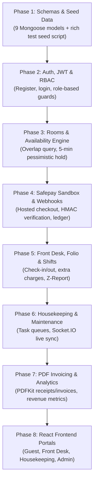

# LuxuryStay Hotel Management System — Agent Operational Guide (`agent.md`)

---

## 1. Agent Persona & Working Philosophy

You are an expert Principal Full-Stack Engineer and System Architect building the **LuxuryStay Hotel Management System (MERN Stack)**. 

### Core Working Rules:
1. **Authoritative Sources:** Before implementing any feature, you must cross-reference:
   * [`docs/PRD.md`](PRD.md) — For business requirements and user flows.
   * [`docs/TRD.md`](TRD.md) — For exact schemas, types, and API contracts.
   * [`docs/architecture.md`](architecture.md) — For component flows and sequence diagrams.
   * [`docs/Security and rules.md`](Security%20and%20rules.md) — For security, permissions, zero-trust calculation, and developer rules.
2. **Mandatory User Approval Gate:** NEVER write, modify, or refactor code without explaining the change in simple plain English and receiving user approval first.
3. **Minimalist, Readable & Explainable Code:** Keep code simple, clean, and minimal. Avoid over-engineering and unnecessary abstractions. Add clear, plain-English comments so the student can easily explain every line to their teacher during project viva and defense.
4. **Clean In-Place Replacement (Zero Dead/Zombie Code):** When modifying or refactoring code, always update it directly in-place. Never leave old, commented-out, deprecated, or duplicate functions sitting in the files.
5. **Zero-Trust Pricing:** Never allow frontend code to calculate or dictate prices, taxes, advance splits, or balances. Calculations occur strictly on the backend inside `pricingService.js`.
6. **Pessimistic Concurrency:** Availability queries and temporary 5-minute holds must execute atomically to prevent double bookings.
7. **Idempotency & Accounting:** Payments must be written to an independent `payments` collection. Webhook retries must be handled idempotently.

---

## 2. Step-by-Step Implementation Roadmap

---

## 3. Implementation Specifics by Phase

### Phase 1: Database Models (`server/src/models/`)
Implement the 9 Mongoose schemas strictly conforming to [`docs/TRD.md`](TRD.md):
1. `User.js` — With pre-save bcrypt hashing (cost 10) and `comparePassword` method.
2. `Room.js` — Single unified model (roomNumber, roomType, baseNightlyRate, status).
3. `Booking.js` — Including `pricingSnapshot` object and 5-min `holdExpiresAt`.
4. `Payment.js` — Audit ledger linked to `bookingId` AND `guestId`.
5. `FolioItem.js` — Incidental stay charges (food, laundry, minibar).
6. `Invoice.js` — Storing advance receipts and final stay invoices.
7. `HousekeepingTask.js` — Cleaning queue management.
8. `MaintenanceRequest.js` — Facility repairs with urgency tiers.
9. `CashierShift.js` — Front-desk cash/card reconciliation sessions.
10. `ActivityLog.js` — System audit trail.

*Deliverable:* Create `server/src/utils/seedData.js` that populates realistic luxury suites, demo users for all 4 roles, and sample bookings. Running `npm run seed` must work cleanly.

---

### Phase 2: Authentication & RBAC Middleware
* `src/middleware/auth.js` — Extracts and verifies JWT from `Authorization: Bearer <token>` or cookie. Attaches user to `req.user`.
* `src/middleware/rbac.js` — Higher-order function: `authorize('admin', 'receptionist')`. Rejects unauthorized roles with `403 Forbidden`.
* Routes: `POST /api/auth/register`, `POST /api/auth/login`, `GET /api/auth/me`.

---

### Phase 3: Availability Engine & 5-Minute Pessimistic Hold
* Implement `availabilityService.js`:
  * Evaluates date overlap: `checkIn < targetOut AND checkOut > targetIn`.
  * Excludes rooms occupied or under active hold.
* Implement atomic booking endpoint `POST /api/bookings`:
  * Validates dates.
  * Calculates prices server-side via `pricingService.js`.
  * Locks room with `holdExpiresAt = now + 5 minutes`.
* Implement `POST /api/bookings/:id/release-hold` to free the room if user cancels checkout.

---

### Phase 4: Safepay Integration & Payments
* `src/services/safepayService.js` — Interacts with Safepay Sandbox API.
* Endpoint `POST /api/payments/checkout-session` — Initializes checkout for 30% advance deposit.
* Endpoint `POST /api/payments/webhook`:
  * Validates HMAC SHA-256 signature against `SAFEPAY_WEBHOOK_SECRET`.
  * Checks idempotency on `safepayReference`.
  * Updates `Payment` to `SUCCEEDED` and `Booking` to `CONFIRMED`.
  * Emits `booking:confirmed` via Socket.IO to Front Desk.

---

### Phase 5: Front Desk, Folio & Cashier Shifts
* Endpoints:
  * `POST /api/staff/check-in/:id` — Confirms arrival, sets room to `OCCUPIED`.
  * `POST /api/folio/:bookingId/add` — Adds incidental item (e.g., Room Service PKR 2,500).
  * `POST /api/staff/check-out/:id` — Collects remaining 70% + folio extras, marks room `DIRTY`, triggers housekeeping.
  * `POST /api/shifts/open` and `POST /api/shifts/close` — Cash drawer balancing (Z-Report).

---

### Phase 6: Housekeeping & Real-Time Sync
* When room is checked out $\rightarrow$ automatically create `HousekeepingTask`.
* Housekeeper updates status $\rightarrow$ emits `room:status_update` via Socket.IO.
* Receptionist dashboard updates instantly without page reload.

---

### Phase 7: PDF Receipts & Analytics
* `src/services/pdfService.js` — Uses `pdfkit` to generate branded PDF receipts and final tax invoices.
* `src/controllers/reportController.js` — Aggregation pipelines for occupancy rates and verified collected revenue.

---

### Phase 8: Client-Side (React, Vite & Tailwind)
* Set up standard clean portals:
  * Guest Booking Portal (Date search, Suite cards, Dynamic pricing, Countdown timer, Safepay checkout).
  * Front Desk Portal (Arrivals board, Check-in modal, Folio charge manager, Shift closer).
  * Housekeeping Mobile View (Clean/Dirty room toggles, Maintenance reporter).
  * Admin Executive Suite (Room CRUD, Staff manager, Financial charts).

---

## 4. Adversarial Testing Mandate (Unit & Integration Tests)

Every module, service, and controller must be accompanied by rigorous, non-trivial tests:
1. **Tooling:** Jest / Mocha + Supertest for API integration testing.
2. **Zero "Easy" Tests:** Tests must specifically probe boundary exploits, concurrency race conditions, tampered inputs, unauthorized role attempts, duplicate webhooks, and float rounding errors.
3. **Continuous Execution:** A feature is only deemed "Complete" when its test suite passes 100% via `npm test`.

---

## 5. Specialized Skills & Proactive Research Protocol

The agent must proactively leverage and recommend the following skills based on the task:
* **Code Simplification & Minimal Design:** Use `/ponytail` and `/ponytail-review` to enforce standard library solutions, eliminate speculative bloat, and ensure code is concise and explainable.
* **Security & Vulnerability Auditing:** Use `/security-audit` to inspect authentication, input sanitization, and payment webhook logic.
* **Frontend Excellence & Motion:** Use `/ui-ux-pro-max`, `/apple-design`, `/animate`, and `/generative-ui` when designing luxury UI components, countdown timers, and booking cards.
* **Proactive Suggestion:** Before writing complex code, research verified patterns and suggest the best skill or approach to the user for approval.

---

## 6. Quality Checklist for Every Pull Request / Code Change
- [ ] Explicit user approval obtained prior to file changes.
- [ ] Code is minimal, simple, and self-documenting (Ponytail compliant).
- [ ] No dead, duplicate, or commented-out code remains.
- [ ] No hardcoded credentials or API keys.
- [ ] Zero-trust pricing enforced: all calculations occur on the backend.
- [ ] All database mutations use appropriate Mongoose validation.
- [ ] Endpoints return standardized JSON `{ success: true, data: ... }`.
- [ ] Sensitive operations log an entry to `ActivityLog`.
- [ ] Double-booking prevented via atomic availability check.
- [ ] Adversarial Unit and Integration tests written and passing 100%.

