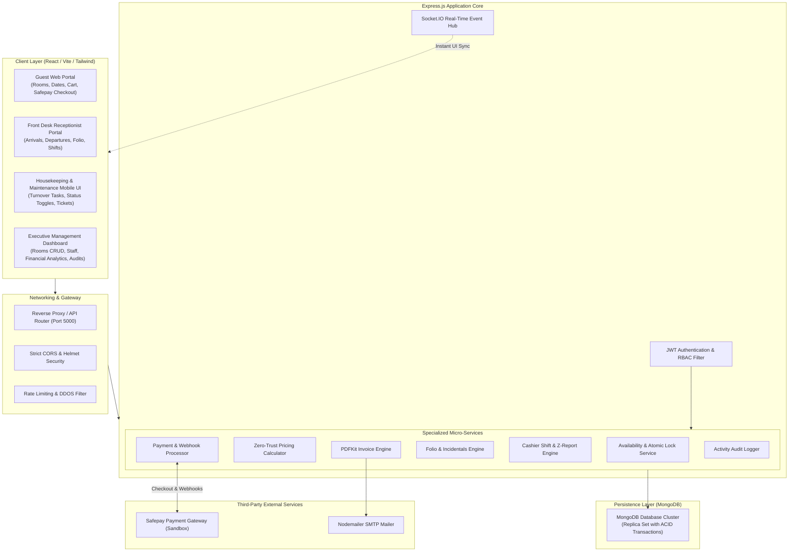
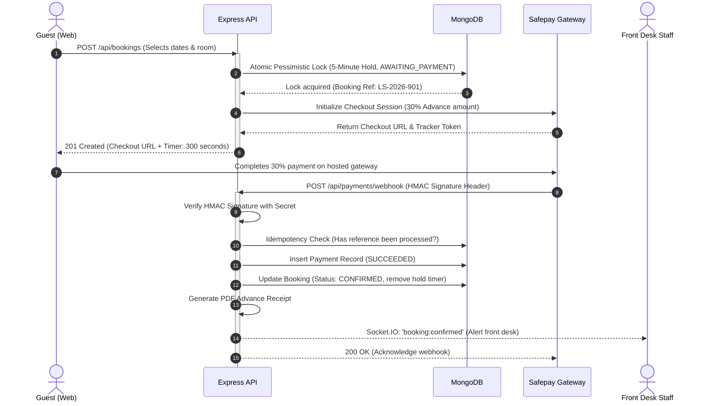
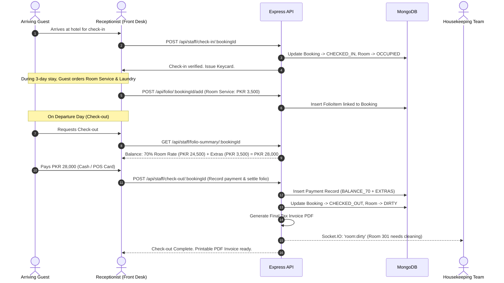
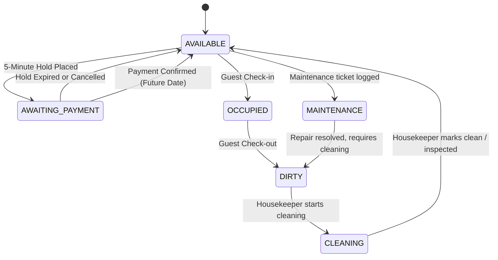
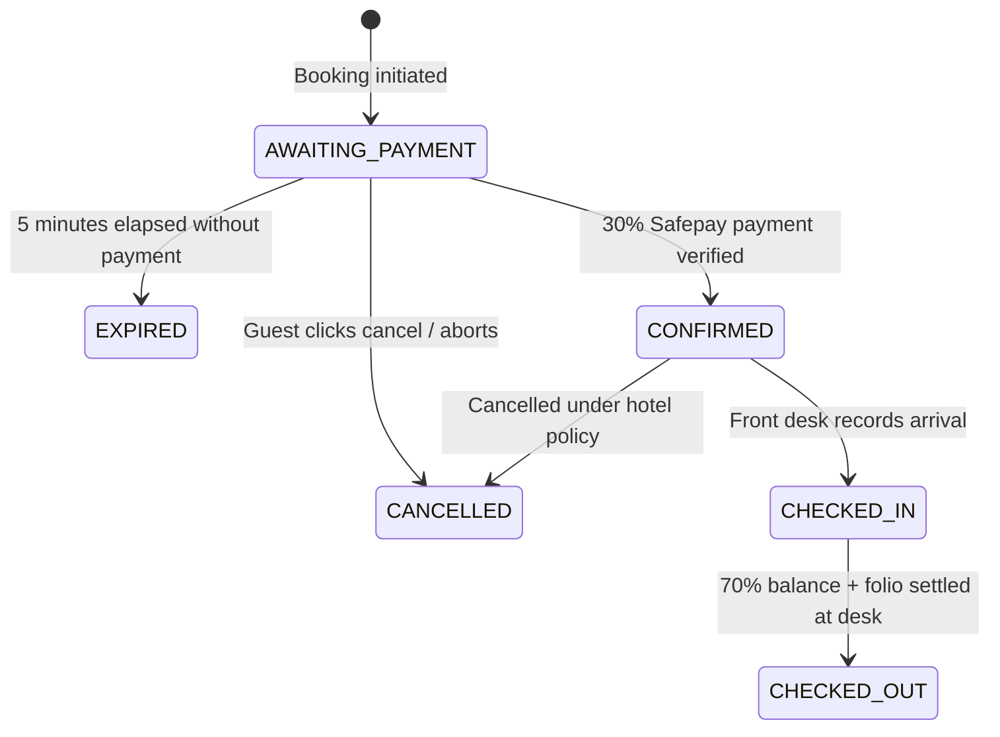
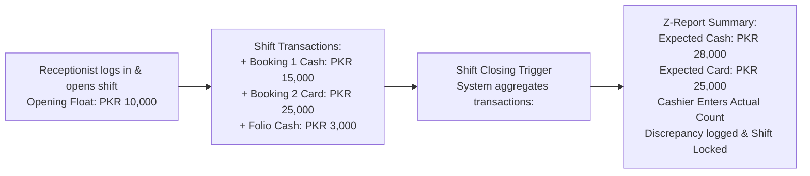

# LuxuryStay Hotel Management System — Architecture Specification

---

## 1. High-Level Component Architecture

---

## 2. End-to-End Sequence Diagrams

### 2.1 The 5-Minute Pessimistic Booking & Safepay Payment Flow

---

### 2.2 Check-in, Incidental Folio & Checkout Flow

---

## 3. Operational State Machines

### 3.1 Room Operational Lifecycle

### 3.2 Booking Lifecycle

---

## 4. Front Desk Cashier Shift Closing (Z-Report Data Flow)

